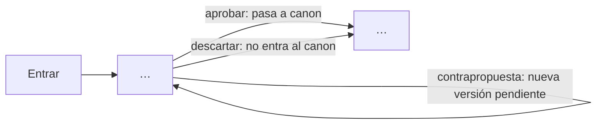
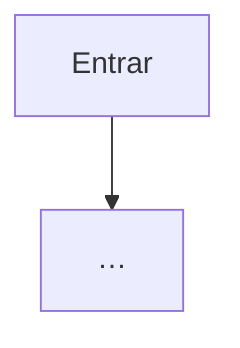

# Mapa de pantallas y flujos — ESP-NNN — <nombre>

```
esp: ESP-NNN
version: 1
estado: BORRADOR
aceptado-por: —
aceptado-fecha: —
experiencia: no hay
```

> **Qué es:** la estructura de la interfaz — pantallas, estados, acciones, flujos,
> navegación y su traza a objetivos y AC. **Qué no es:** maqueta, diseño visual,
> componentes, ni la sensación del producto (eso es experiencia.md, si existe).
> No define AC: los cita.
>
> `estado:` admite `BORRADOR`, `EN_REVISION` o `ACEPTADO`. Solo un humano escribe `ACEPTADO`.
> En el repo de un producto, este archivo es una **copia fija, byte a byte**, y no se edita
> ahí. Su origen y su hash los declara `proyecto-<nombre>.md` (`mapa-origen:`), no este archivo.

## Pantallas

Una sección por pantalla. Los IDs `PANnn` son estables: una pantalla que sale queda con
`vigencia: retirada` y su ID no se reutiliza. Una pantalla que se parte o se fusiona
retira las originales y crea IDs nuevos con `reemplaza: PANnn`.

### PAN01 · <nombre>

```
vigencia: vigente
actor: <actor>; <otro actor: qué ve o puede distinto>
proposito: <una línea>
muestra: <entidad.campo, …>
pide: <datos que el actor entrega>
acciones: <acción>, <acción destructiva (confirma con nombre)>
vacio: <qué ve> → <siguiente paso>
carga: <qué ve> → <siguiente paso>   (incluye esperas largas del agente)
error: <qué ve> → <siguiente paso>
dominio: <estado de dominio>: <qué cambia>; …   (o —)
comparte: —   (o «igual que PANnn: <parte>»)
traza: O1, AC1
```

Las celdas `vacio`, `carga` y `error` admiten `N/A — <razón>`. Vacías no.

## Flujos

IDs `FLUnn`. Los nodos son IDs de pantalla. **Sintaxis permitida, y nada más:**
`flowchart TD` o `flowchart LR`; nodos `PANnn["nombre"]`; aristas `-->` y
`-->|"acción: efecto"|` (la etiqueta siempre entre comillas). Incluir aprobar,
descartar, contrapropuesta, cancelar y los errores relevantes cuando el dominio los tiene.

### FLU01 · <nombre> — actor: <actor> — traza: O1, AC1



## Navegación

```
entrada: PAN01
persistente: PAN02, PAN03
```



Toda pantalla vigente es alcanzable desde la entrada (por navegación, por un flujo o
por estar en `persistente`).

## AC sin superficie

La cobertura **con superficie la calcula el verificador** a partir de las trazas.
Aquí solo se escriben los AC que no tienen pantalla, con su razón. Se admiten rangos.

```
AC10: modelo sin UI en v1
AC40–AC62: motor de reglas, sin superficie propia
```

## Abiertas del mapa

Lo que el registro no dice y quien rellena no debe inventar.

| ID | Pregunta | ¿bloquea? |
|---|---|---|
| MA1 | | sí/no |

## Lo que este mapa NO asegura aunque el verificador esté en verde

- Que estén todas las pantallas que el producto necesita.
- Que estén todos los caminos de aprobar, descartar y cancelar que el dominio tiene.
- Que los estados estén diseñados y no solo nombrados.
- Que la traza sea correcta (solo que el ID existe).
- Que las razones `N/A` y «sin superficie» sean ciertas.
- Que `ACEPTADO` lo haya escrito un humano.
- Que la copia del producto sea la que se aceptó: el verificador solo comprueba que no se editó después de copiarla (hash declarado), no que el hash declarado sea el del mapa aceptado.
- Que el producto construido corresponda al mapa.

## Aceptación

- [ ] Verificador del mapa en verde, en una ejecución que no es del agente que lo redactó
- [ ] Cada flujo recorrido de punta a punta sin pantallas inventadas en el camino
- [ ] Ninguna abierta del mapa con `bloquea: sí`
- [ ] Cada AC sin superficie tiene una razón compartida
- [ ] `vacio` y `error` dicen el siguiente paso
- [ ] Si hay experiencia.md: no repite lista ni flujo
